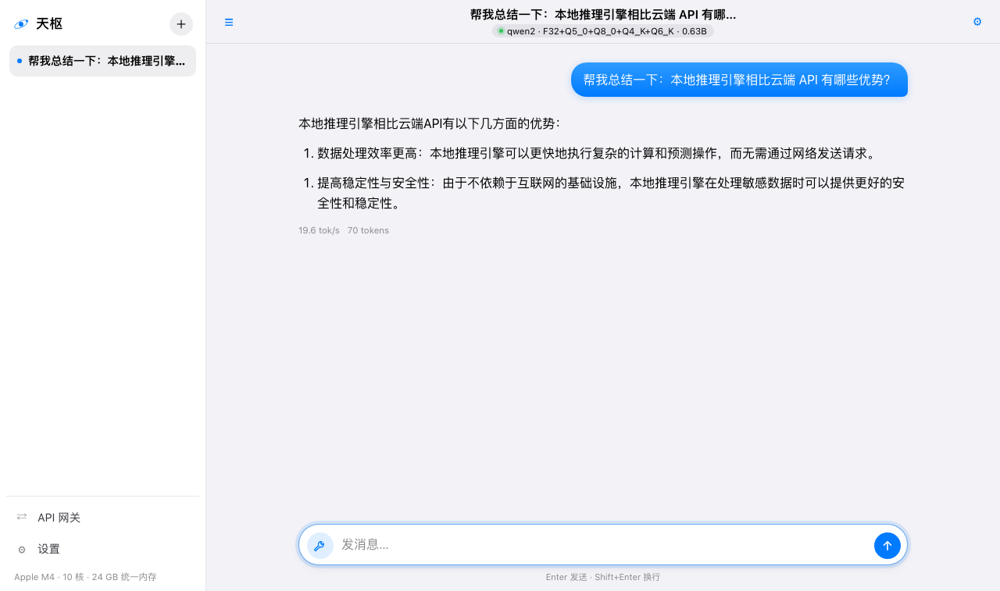

# 天枢 · Dubhe

> Apple Silicon MacBook 与 Android 手机上的本地大模型推理引擎。GGUF 原生直读，单路与多路都不掉速。

状态：M0 已交付（引擎 + CLI + HTTP + Web UI 全链路可跑）· **M1 Metal GPU 后端 + 批处理 prefill 已上线** · 闭源 · 私有仓库

---

## 快速开始

```bash
make                        # 零外部依赖，只需要 Xcode 命令行工具
make check                  # 一条命令自检：加载 → 分词 → 前向 → 生成（GPU + CPU 双路径）
make optest                 # 7 个 Metal 融合算子逐个和 C 参考实现对拍

# 命令行对话
./build/dubhe chat -m ~/.dubhe/models/qwen2.5-0.5b-instruct/qwen2.5-0.5b-instruct-q4_k_m.gguf

# 带 UI 的本地服务（浏览器打开 http://127.0.0.1:7777）
./build/dubhed -m <model.gguf>

# 分享给手机 / 局域网（自动生成 API Key）
./build/dubhed -m <model.gguf> --share
```

实测（Qwen2.5-0.5B-Instruct-Q4_K_M，M4 24GB，短上下文）：

| 后端 | decode | prefill |
| --- | --- | --- |
| CPU · NEON | 20.6 tok/s | 21.3 tok/s |
| **Metal GPU** | **79–84 tok/s** | **382 tok/s** |

长上下文（631 token 提示）GPU 侧：prefill **276–318 tok/s**，decode
**47–52 tok/s**。同一台机器上 CPU 路径是 25 / 23 tok/s。

> 这台测试机的绝对带宽只有真实 M4 的约 1/6（裸带宽实测 17 GB/s，真机应在
> 100 GB/s 量级），所以绝对数字仅供参考，**倍数**是背靠背交替测量得出的。

数值一致性：GPU 与纯 f32 基准逐位置 logits 最大差 **3e-5**、cosine
1.000000；631 token 上下文下贪心输出与 CPU **逐字一致**。
`make gpu` 复现性能对比，`make optest` 逐个算子对拍。

## 界面

| 对话 | API 网关 | 设置（移动端） |
| --- | --- | --- |
|  |  |  |

## 一句话

让个人设备把大模型真正跑起来、跑得久、跑得省，并且不要求用户"先转换一下"。

## 核心主张

| 别人的问题 | 我们的做法 |
| --- | --- |
| 单路快就多路慢，多路快就单路慢 | 双工况调度（ADRS）+ 分形状 Kernel，两条曲线同时压住 |
| 手机跑 10 分钟就降频，benchmark 只测前 60 秒 | 热感知控制器，持续 tokens/J 是正式指标 |
| Mac 上 GGUF 与 MLX 是两套世界 | 三图 IR（Compute / Quant / State），两种格式原生直读 |
| 只能二选一：速度或正确 | 先过 parity 门禁，再谈性能；过不了就不许提交 |

## 交付物

| 名称 | 形态 | 状态 |
| --- | --- | --- |
| `libdubhe` | C++ 库 + 稳定 C ABI（`dubhe.h`） | ✅ M0 |
| `dubhe` | CLI：`inspect` / `run` / `chat` / `bench` | ✅ M0 |
| `dubhed` | 本地 HTTP 服务，OpenAI 兼容 + SSE 流式 | ✅ M0 |
| Web UI | iOS 风格单页应用（会话 / Markdown / 工具卡片 / 网关面板） | ✅ M0 |
| 工具调用 | `read_file` `list_dir` `write_file` `shell` | ✅ M0 |
| API 网关 | `--share` 局域网共享 + `sk-dubhe-…` 密钥 | ✅ M0 |
| `dubhe-bench` | 与 llama.cpp / MLX 对打的基准客户端 | M1 |
| Metal 后端 | 运行时编译 MSL，整层前向单 command buffer，权重零拷贝 | ✅ M1 |
| 批处理 prefill | 权重读一遍喂 8 个 token，激活转置成 `[n_in][8]` 用 `float4` 取 | ✅ M1 |
| split-K 注意力 | 长上下文按 key 区间切 8 段并行，combine 归并 | ✅ M1 |
| Android | NDK + NEON + NPU | M4 |
| 双端原生 App | SwiftUI / Compose | M5 |

## 已实现的量化内核

| 类型 | 位解包 | f32 路径 | NEON 整数路径 | Metal |
| --- | --- | --- | --- | --- |
| F32 / F16 | ✅ | ✅ | — | ✅ |
| BF16 | ✅ | ✅ | — | — |
| Q4_0 / Q4_1 | ✅ | ✅ | ✅ | ✅ / — |
| Q5_0 / Q5_1 | ✅ | ✅ | ✅ | ✅ / — |
| Q8_0 | ✅ | ✅ | ✅ | ✅ |
| Q4_K / Q6_K | ✅ | ✅ | ✅ | ✅ |
| Q5_K | ✅ | ✅ | 待补 | 待补 |

全部通过 `tests/test_quant.cpp` 的位解包自检（相对误差 ≤ 1.6e-7）
与整数路径一致性自检（≤ 9.1e-4，属激活量化噪声）。

## 技术栈

C++20 / Objective-C++（内核）· ARM NEON + `vdotq_s32`（整数点积）·
libdispatch（行并行）· Metal Shading Language（运行时编译，零拷贝统一内存，
simdgroup 级并行）· 零外部依赖构建（只用系统 clang）

## 目录

```
docs/      开发书 / 进度书 / ADR / RFC
engine/    推理内核（include/dubhe 是唯一对外接口）
cli/       dubhe 命令行
server/    dubhed（HTTP + OpenAI 兼容 API）
web/       iOS 风格前端
tests/     数值自检
bench/     内核吞吐基准
tools/     自检 / 元数据转储 / UI 截图
```

## 文档（先读这两份）

| 文档 | 内容 |
| --- | --- |
| [总开发书](docs/00-总项目开发书.md) | 做什么、不做什么、怎么验收、里程碑、协作模式 |
| [进度书](docs/02-进度书.md) | 现在到哪了、卡在哪、下一轮做什么（含 M0 三轮实施记录） |
| [引擎开发书索引](docs/01-推理引擎开发书-索引.md) | 内核技术规格（正文在 `docs/references/`） |
| [ADR](docs/adr/README.md) | 每个不可逆选择为什么这么定 |

## 开发模式

**AI 写全部代码，人类只做验证与拍板。** 时间单位是 Round：

```
我交付可运行增量 → 你跑一条命令（≤5 分钟）→ 回传输出 → 我修 → 下一轮
```

所以每个交付都自带"一条命令 + 预期输出"，验证不需要读代码。

## 许可

闭源（Proprietary）。复用的第三方组件（MIT / Apache-2.0 / BSD）声明见 `THIRD_PARTY_NOTICES.md`。
**GPL/AGPL 一律不进。** 详见 [ADR-0006](docs/adr/ADR-0006-许可证策略.md)。
