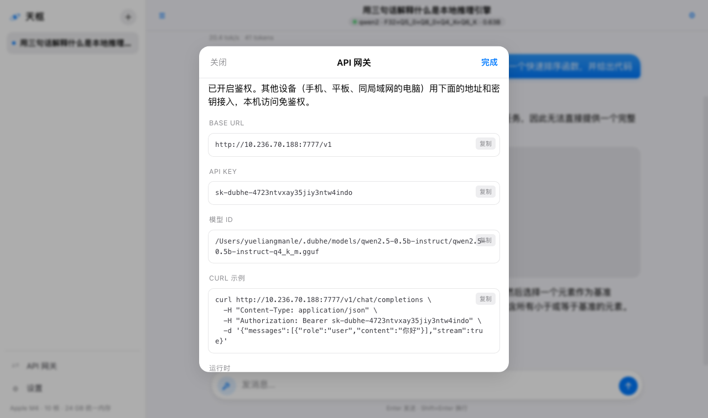
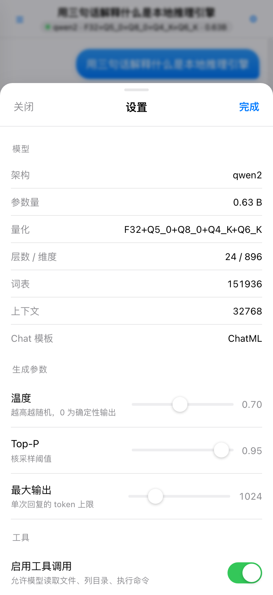

# 天枢 · Dubhe

> Apple Silicon MacBook 与 Android 手机上的本地大模型推理引擎。GGUF 原生直读，单路与多路都不掉速。

状态：**v0.25.0** · M0 已交付（引擎 + CLI + HTTP + Web UI 全链路可跑）· **M1 性能收敛**（prefill 追平 MLX，decode 贴着带宽墙）· **Qwen3.5 混合架构**（Gated DeltaNet + 176K 上下文，decode 15 tok/s / prefill 113 tok/s）· macOS 客户端（双击即开、拖 gguf 换模型、生成完成通知）已落地 · 闭源 · 私有仓库

---

## 快速开始

```bash
make                        # 零外部依赖，只需要 Xcode 命令行工具
make check                  # 一条命令自检：加载 → 分词 → 前向 → 生成（GPU + CPU 双路径）
make optest                 # 7 个 Metal 融合算子逐个和 C 参考实现对拍

# 命令行对话
./build/dubhe chat -m ~/.dubhe/models/qwen2.5-0.5b-instruct/qwen2.5-0.5b-instruct-q4_k_m.gguf

# 带 UI 的本地服务（浏览器打开 http://127.0.0.1:7777）
./build/dubhed -m <model.gguf>

# 分享给手机 / 局域网（自动生成 API Key）
./build/dubhed -m <model.gguf> --share
```

实测（M4 / 10 核 / 24 GB，2026-11-03，`dubhe bench` 三次取均值）：

**LFM3-1.7B（tri-hybrid，1.73B 参数）**

| 后端 | 权重 | 体积 | decode | prefill |
| --- | --- | ---: | ---: | ---: |
| 天枢 Metal | Q4_K_M | 1.10 GB | **58.7 tok/s** | **369 / 443 tok/s** |
| 天枢 Metal | Q8_0 | 1.85 GB | 36.5 tok/s | 389 tok/s |
| 天枢 Metal | F16 | 3.47 GB | 22.7 tok/s | 364 tok/s |
| 天枢 CPU · NEON | Q4_K_M | 1.10 GB | 13.5 tok/s | 14.0 tok/s |
| 苹果 MLX | 4bit | 0.97 GB | 87.1 tok/s | 495 tok/s |
| 苹果 MLX | 8bit | 1.90 GB | 47.9 tok/s | — |

prefill 的两个数是「短提示 / 904 token 长文」。MLX 的 495 是 601 token 读数，
按量级对齐后差距约 1.1x，**已经不是短板**：0.5.0 的二维分块 + 0.15.3 的 MMA
把 prefill 推到 2.19 TFLOP/s，是 M4 上 8×8×8 MMA 天花板（2.72 TFLOP/s）的 81%。

剩下的差距在 decode（58.7 vs 87.1 = 0.67x）。原因不是内核效率 —— 解码已经
跑在 84 GB/s、贴着这台机器的只读带宽上限 —— 而是 GGUF Q4_K_M（1.10 GB）
比 MLX 4bit（0.97 GB）大 13%。同体积下两者基本同速。

**Qwen2.5-0.5B-Instruct Q4_K_M**

| 后端 | decode | prefill |
| --- | --- | --- |
| CPU · NEON | 20.6 tok/s | 21.3 tok/s |
| **Metal GPU** | **79–84 tok/s** | **382 tok/s** |

**MiMo-V2.6-Distill-Qwen-9B（Qwen3.5 混合架构，5.44 GB）**

32 层里有 24 层是 Gated DeltaNet（递归状态固定 50 MB，不随上下文涨），
8 层是 gated full attention。

| 后端 | 上下文 | decode | prefill |
| --- | ---: | ---: | ---: |
| CPU · NEON | 短 | 4.4 tok/s | 3.9 tok/s |
| **Metal GPU** | 短 | **15.0 tok/s** | **113 tok/s**（稳定态） |
| Metal GPU | 681 | 13.4 tok/s | 71 tok/s（含冷启动） |
| Metal GPU | 2111 | 10.9 tok/s | 80 tok/s（含冷启动） |

prefill 的稳定态是每 32 token 一叠 282 ms = 2.03 TFLOP/s，达到 M4 上
8×8×8 fp32 MMA 峰值的 75%，已经没有多少余量。681 token 的墙钟之所以是
9.6 秒，是因为第一叠要付约 3.6 秒把 5.44 GB 权重从盘上读进来（mmap
按需缺页，约 1.5 GB/s）—— 这是 I/O，不是内核。

可用的上下文是 **176 896 token**（8 层 fp16 KV，占 5.8 GB）。KV 容量不是写死的：
启动时按 `recommendedMaxWorkingSetSize` 减去权重算，装不下才收紧；
`DUBHE_KV_CAP=32768` 可以手动压小（省内存的诊断/调优口子）。

数值一致性：GPU 与 CPU 逐层残差流的 RMS 差 < 0.6%（f16 KV + 量化舍入），
681 token 提示下贪心输出与逐 token 路径**逐字一致**。
`DUBHE_NO_PREFILL=1` 关掉批量 prefill 可做 A/B，`DUBHE_Q35_DUMP=1` 打印
GPU 逐层指纹对拍 CPU 的 `DUBHE_DEBUG_NAN=1`。

数值一致性：GPU 与纯 f32 参考逐位置 logits 最大差 **9.4e-6**、argmax 一致；
631 token 上下文下贪心输出与 CPU **逐字一致**。
`make gpu` 复现性能对比，`make optest` 逐个算子对拍，
`DUBHE_FUSED_CHECK_VERBOSE=1` 打印逐位置对拍明细。

> 同一台机器有其它负载时 decode 会明显掉（实测见过 58 → 13 tok/s），
> 所以绝对数字只反映当时负载；要横向比较时用 `tools/ab.py` 的
> **交错配对 + 取比值中位数**，不要拿两次不同会话的绝对值相除。
> 完整的精度 × 后端矩阵见
> [LFM3 精度与后端实测](docs/references/LFM3-精度与后端实测.md)。

## 多模态：图、视频、语音

Liquid 的多模态是一条谱系，**语言主干完全相同，能力全在独立的 mmproj 里**。
所以引擎只有一套"读 mmproj → 编码 → 按位置注入嵌入"的机制，换塔就换能力。

```bash
# 图像（LFM3-VL-2B）
./build/dubhe run -m LFM3-VL-2B-Q4_K_M.gguf --mmproj mmproj-LFM3-VL-2B-Q8_0.gguf \
    --image pic.png -p "<|image|>描述这张图"

# 视频（同一份 mmproj；--video-fps / --video-frames / --video-side 控制抽帧）
./build/dubhe run -m LFM3-VL-2B-Q4_K_M.gguf --mmproj mmproj-LFM3-VL-2B-Q8_0.gguf \
    --video clip.mp4 -p "<|video|>这段视频里发生了什么"

# 语音（LFM3-Audio-2B；wav / mp3 / m4a / flac 都行，内部自动重采样到 16 kHz）
./build/dubhe run -m LFM3-Audio-2B-Q4_K_M.gguf --mmproj mmproj-LFM3-Audio-2B-Q8_0.gguf \
    --audio clip.wav -p "<|audio|>把这段语音转写成文字"
```

| 模态 | 塔 | 规模 | 耗时 |
| --- | --- | --- | ---: |
| 图像 | LFM3-VL 视觉塔（14 层） | 161 M | 3.5 s / 384² · 13.5 s / 640² |
| 视频 | 同上（每 2 帧一个 temporal patch） | — | 28 s / 8 帧 512² |
| 语音 | LFM3-Audio（降采样 + 17 层 LFM2） | 109 M | **0.2 s / 3.45 s 音频** |

精度：两座塔都与 HuggingFace 官方 forward **逐层对拍**过 —— 视觉 16 个检查点
（相对误差 1.7e-5）、语音 22 个检查点（≤6.2e-6），余弦相似度 1.000000。
端到端：图像能说对颜色形状，视频能判对运动方向（静止视频不会被描述成在动），
语音转写逐字正确。

### 走 HTTP：手机和网页也能用

`--mmproj` 可以给多次（Omni 是视觉塔 + 语音塔两个文件），服务端按
OpenAI 的 content 数组收媒体：

```bash
./build/dubhed -m LFM3-VL-2B-Q4_K_M.gguf \
    --mmproj mmproj-LFM3-VL-2B-Q8_0.gguf \
    --mmproj mmproj-LFM3-Audio-2B-Q8_0.gguf \
    --share
```

```jsonc
{"messages":[{"role":"user","content":[
  {"type":"image_url","image_url":{"url":"data:image/png;base64,..."}},
  {"type":"text","text":"这张图里是什么"}
]}]}

{"messages":[{"role":"user","content":[
  {"type":"video_url","video_url":{"url":"data:video/mp4;base64,..."}}
]}]}

{"messages":[{"role":"user","content":[
  {"type":"input_audio","input_audio":{"data":"<base64>","format":"wav"}}
]}]}
```

Web UI 输入框左侧的 `+` 就是干这个的，`accept` 按服务端实际能力动态拼。
**只给音频、不打字**时会自动走转写模式（见 [进度书 §9.11](docs/02-进度书.md)）。

HTTP 端到端：图像 6.8 s / 视频 13.1 s / 语音 4.3 s（decode 50–60 tok/s，
和纯文本一致 —— 嵌入注入没有额外开销）。

## 界面

| 对话 | API 网关 | 设置（移动端） |
| --- | --- | --- |
|  |  |  |

输入框上方三个开关决定这一条消息怎么生成：

| 开关 | 作用 | 关掉之后 |
| --- | --- | --- |
| 思考过程 | 把模型内部的推理折成可折叠块显示 | **推理照旧进行**，只是不显示 |
| 工具调用 | 允许读文件、跑命令、算术 | 只能靠模型自己的知识回答 |
| 联网搜索 | 先搜再答（需要联网权限） | 只用训练时记住的东西 |

有思考通道的模型（LFM3 这类）无论如何都会先想一遍，所以「思考过程」控制的是
“给不给你看”，不是“想不想”。关掉时推理会被丢弃、正文只留答案；如果它把全部
输出预算都花在推理上，界面会直说，而不是留一个空气泡。

另外，**整句就是一个算式**时（`887乘以7737等于多少`、`3+6等于多少`）服务端会
直接算，一个 token 都不生成。带解释、带单位的问法不在此列，照常交给模型。

## Android

引擎在 Android 上走纯 CPU（NEON + 自建线程池），Metal 换成 stub，
图像/音频解码暂时也是 stub。交叉编译：

```bash
# 一次性：装 NDK
~/Library/Android/sdk/cmdline-tools/latest/bin/sdkmanager "ndk;27.2.12479018"

make PLATFORM=android            # → build-android-arm64-v8a/dubhe（ELF aarch64）
make PLATFORM=android ANDROID_ABI=armeabi-v7a
```

产物与本机 `build/` 完全隔离。线程数可用 `DUBHE_THREADS` 覆盖：

```bash
adb push build-android-arm64-v8a/dubhe /data/local/tmp/
adb shell chmod 755 /data/local/tmp/dubhe
adb shell DUBHE_THREADS=4 /data/local/tmp/dubhe run -m model.gguf -p "你好" --stats
```

模拟器（Android 13 / arm64-v8a / 3 核）实测 0.5B Q4_K_M decode 19.8–25.5 tok/s、
输出连贯中文 —— **这只证明能跑且正确，性能必须真机重测**。

## 一句话

让个人设备把大模型真正跑起来、跑得久、跑得省，并且不要求用户"先转换一下"。

## 核心主张

| 别人的问题 | 我们的做法 |
| --- | --- |
| 单路快就多路慢，多路快就单路慢 | 双工况调度（ADRS）+ 分形状 Kernel，两条曲线同时压住 |
| 手机跑 10 分钟就降频，benchmark 只测前 60 秒 | 热感知控制器，持续 tokens/J 是正式指标 |
| Mac 上 GGUF 与 MLX 是两套世界 | 三图 IR（Compute / Quant / State），两种格式原生直读 |
| 只能二选一：速度或正确 | 先过 parity 门禁，再谈性能；过不了就不许提交 |

## 交付物

| 名称 | 形态 | 状态 |
| --- | --- | --- |
| `libdubhe` | C++ 库 + 稳定 C ABI（`dubhe.h`） | ✅ M0 |
| `dubhe` | CLI：`inspect` / `run` / `chat` / `bench` | ✅ M0 |
| `dubhed` | 本地 HTTP 服务，OpenAI 兼容 + SSE 流式 | ✅ M0 |
| Web UI | iOS 风格单页应用（会话 / Markdown / 工具卡片 / 网关面板） | ✅ M0 |
| 工具调用 | `read_file` `list_dir` `write_file` `shell` | ✅ M0 |
| API 网关 | `--share` 局域网共享 + `sk-dubhe-…` 密钥 | ✅ M0 |
| `dubhe-bench` | 与 llama.cpp / MLX 对打的基准客户端 | M1 |
| Metal 后端 | 运行时编译 MSL，整层前向单 command buffer，权重零拷贝 | ✅ M1 |
| 批处理 prefill | 权重读一遍喂 8 个 token，激活转置成 `[n_in][8]` 用 `float4` 取 | ✅ M1 |
| split-K 注意力 | 长上下文按 key 区间切 8 段并行，combine 归并 | ✅ M1 |
| LFM3 tri-hybrid | ShortConv / QK RMSNorm / sigmoid 输出门 / zero-tail partial RoPE / 滑窗注意力，CPU + Metal 双路径 | ✅ M1 |
| 苹果 MLX 参考实现 | `tools/mlx_lfm3.py` 补上 mlx-lm 缺失的 lfm3，用于交叉验证与基准 | ✅ M1 |
| Android | NDK + NEON + NPU | M4 |
| 双端原生 App | SwiftUI / Compose | M5 |

## 已实现的量化内核

| 类型 | 位解包 | f32 路径 | NEON 整数路径 | Metal |
| --- | --- | --- | --- | --- |
| F32 / F16 | ✅ | ✅ | — | ✅ |
| BF16 | ✅ | ✅ | — | — |
| Q4_0 / Q4_1 | ✅ | ✅ | ✅ | ✅ / — |
| Q5_0 / Q5_1 | ✅ | ✅ | ✅ | ✅ / — |
| Q8_0 | ✅ | ✅ | ✅ | ✅ |
| Q4_K / Q6_K | ✅ | ✅ | ✅ | ✅ |
| Q5_K | ✅ | ✅ | 待补 | 待补 |

全部通过 `tests/test_quant.cpp` 的位解包自检（相对误差 ≤ 1.6e-7）
与整数路径一致性自检（≤ 9.1e-4，属激活量化噪声）。

## 技术栈

C++20 / Objective-C++（内核）· ARM NEON + `vdotq_s32`（整数点积）·
libdispatch（行并行）· Metal Shading Language（运行时编译，零拷贝统一内存，
simdgroup 级并行）· 零外部依赖构建（只用系统 clang）

## 目录

```
docs/      开发书 / 进度书 / ADR / RFC
engine/    推理内核（include/dubhe 是唯一对外接口）
cli/       dubhe 命令行
server/    dubhed（HTTP + OpenAI 兼容 API）
web/       iOS 风格前端
tests/     数值自检
bench/     内核吞吐基准
tools/     自检 / 元数据转储 / UI 截图
```

## 文档（先读这两份）

| 文档 | 内容 |
| --- | --- |
| [总开发书](docs/00-总项目开发书.md) | 做什么、不做什么、怎么验收、里程碑、协作模式 |
| [进度书](docs/02-进度书.md) | 现在到哪了、卡在哪、下一轮做什么（含 M0 三轮实施记录） |
| [引擎开发书索引](docs/01-推理引擎开发书-索引.md) | 内核技术规格（正文在 `docs/references/`） |
| [ADR](docs/adr/README.md) | 每个不可逆选择为什么这么定 |

## 开发模式

**AI 写全部代码，人类只做验证与拍板。** 时间单位是 Round：

```
我交付可运行增量 → 你跑一条命令（≤5 分钟）→ 回传输出 → 我修 → 下一轮
```

所以每个交付都自带"一条命令 + 预期输出"，验证不需要读代码。

## 许可

闭源（Proprietary）。复用的第三方组件（MIT / Apache-2.0 / BSD）声明见 `THIRD_PARTY_NOTICES.md`。
**GPL/AGPL 一律不进。** 详见 [ADR-0006](docs/adr/ADR-0006-许可证策略.md)。
