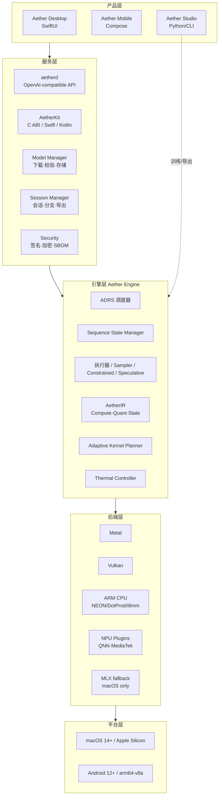
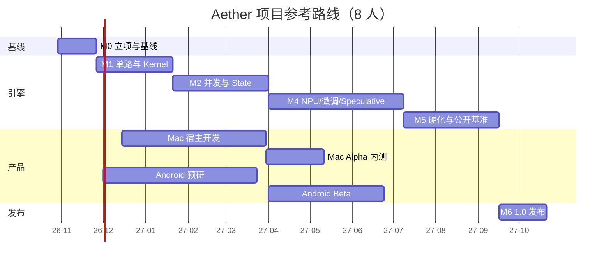

# Aether 项目开发书（总纲）

| 项目代号 | Aether |
| --- | --- |
| 文档编号 | AETHER-DEV-000 |
| 版本 | v1.0 |
| 状态 | 已立项（M0 进行中） |
| 立项日期 | 2026-10-29 |
| 最后更新 | 2026-10-29 |
| 文档负责人 | Tech Lead |
| 关联文档 | [AETHER-DEV-001 推理引擎开发书](01-推理引擎开发书-索引.md)、[AETHER-PRG-000 进度书](02-进度书.md)、[ADR 索引](adr/README.md) |

> 本文是**总项目**开发书，回答"我们要造一个什么产品、怎么组织、怎么验收"。
> 推理内核的技术规格、竞品矩阵、Kernel 级优化方案不在本文重复，统一由 [AETHER-DEV-001] 承载。两份文档是父子关系，不是并列关系。

---

## 0. 文档体系与使用规则

### 0.1 四层文档

| 层级 | 文档 | 回答什么问题 | 更新频率 | 谁写 |
| --- | --- | --- | --- | --- |
| L0 | **总项目开发书**（本文） | 产品是什么、架构怎么分、里程碑怎么排、怎么验收 | 每个里程碑评审一次 | Tech Lead + PM |
| L1 | **推理引擎开发书** AETHER-DEV-001 | 内核怎么实现、Kernel 怎么调、基准怎么打 | 每个阶段（P0–P5）更新 | 引擎负责人 |
| L2 | **ADR**（架构决策记录） | 某个不可逆选择为什么这么定 | 一次性，永不修改（只追加废弃标记） | 决策提出者 |
| L2 | **RFC**（方案提案） | 一个待定方案的技术细节与取舍 | 合入后归档 | 提案者 |
| L3 | **进度书** AETHER-PRG-000 | 现在到哪了、卡在哪、下周干什么 | 每周五 | 全员填报，PM 汇总 |

### 0.2 三条硬规则

1. **文档与代码同 PR。** 任何改变行为、接口、指标口径的 PR，必须同时修改对应文档；文档未更新的 PR 不予合入。
2. **ADR 只追加不覆盖。** 决策变了就新写一条 ADR 并把它标记为 `Supersedes ADR-000X`，不允许回头改历史。
3. **进度书按周追加，不回头美化。** 只允许在"事实纠错"场景下修改历史记录，并留一行修订说明。

### 0.3 编号规范

```
AETHER-DEV-000   总项目开发书
AETHER-DEV-001   推理引擎开发书
AETHER-DEV-01x   子系统规格（桌面端 / 移动端 / 服务端 / 基准）
AETHER-PRG-000   进度书（唯一，按周追加）
ADR-000N         架构决策
RFC-000N         方案提案
```

---

## 1. 项目定义

### 1.1 一句话

> **Aether 是一套让个人设备（Apple Silicon MacBook 与 Android 旗舰手机）把大模型真正跑起来、跑得久、跑得省、并且能持续个性化的本地 AI 执行系统。**

它由三层构成：**推理内核（Engine）** 负责把 token 生成得最快最省；**设备运行时（Runtime/Service）** 负责在操作系统里活下来、被别的应用调用；**产品层（Desktop / Mobile / Studio）** 负责让非工程用户真的用得上。

### 1.2 要解决的真问题

不是"再做一个能跑 Llama 的 App"。今天能跑 Llama 的 App 至少有二十个。真正没被解决的是这四件事：

| # | 真问题 | 现状 | Aether 的回答 |
| --- | --- | --- | --- |
| P1 | **单路快 ≠ 多路快** | 现有引擎在 B=1 和 B=8 之间必须二选一，agent 并发场景普遍掉到单路的 1/3 | 双工况调度（ADRS）+ 分形状 Kernel，两条曲线同时压住 |
| P2 | **长跑必降频** | 手机跑 10 分钟就烫、Mac 跑 30 分钟风扇狂转，benchmark 只测前 60 秒 | 热感知控制器把"持续 tokens/J"当一等指标，soak 是正式门禁 |
| P3 | **格式割裂** | Mac 上 GGUF 与 MLX 是两套世界，用户要"先转换一下"；Android 又是第三套 | 格式无关 IR，GGUF 与 MLX 目录**原生直读**，AetherPack 只是可选预优化 |
| P4 | **个性化断链** | 微调在另一台机器、另一个工具里做，做完不知道怎么安全地回到设备上跑 | 本地 adapter 生命周期闭环：训练 → 评测 → 量化感知导出 → 部署 parity |

### 1.3 目标用户

| 画像 | 场景 | 为什么选我们 |
| --- | --- | --- |
| **本地优先的知识工作者** | 处理合同、财报、代码库、私人笔记，不能上云 | 数据零出网、长上下文、会话可 fork |
| **AI 应用开发者** | 要在自己 App 里嵌本地模型，不想绑云 API | AetherKit SDK + 稳定的 C ABI + 可预期的延迟 SLA |
| **多 agent 自动化玩家** | 一台 Mac 上并行跑 4–16 个 agent 处理批量任务 | 并发吞吐是核心卖点，不是副作用 |
| **企业/团队的隐私部署** | 内网、无网环境、受监管行业 | 签名模型、离线模式、可审计 manifest |

### 1.4 明确不做（边界）

写清楚"不做什么"比写"做什么"更能保护工期：

- ❌ **不做云端推理服务**。没有 GPU 集群，没有按 token 计费的 API。
- ❌ **不做模型训练平台**。只做 LoRA/QLoRA 级别的本地个性化，不做全量预训练。
- ❌ **不做通用 Agent 编排框架**。提供 Agent 需要的原语（并发、state fork、结构化输出），不提供 workflow 编辑器。
- ❌ **不支持 Intel Mac、不支持 32 位 ARM、不支持 4 GB 内存设备**。低于这条线的设备体验必然崩，不做慈善兼容。
- ❌ **不做模型分发市场（M1–M4）**。只做模型库管理，不承担模型版权审核与分成；M5 之后再评估。

### 1.5 成功标准（三层，缺一不可）

| 层 | 标准 | 验收时点 |
| --- | --- | --- |
| 技术 | AetherBench 核心矩阵 ≥80% 场景第一；任何战略场景落后最佳者不超过 10%（细则见 AETHER-DEV-001 §6） | M5 |
| 产品 | 首次安装到出第一个 token ≤ 5 分钟（含 4B 模型下载）；7 日留存 ≥ 35%；崩溃率 < 0.5%/会话 | M6 + 90 天 |
| 商业 | 付费转化 ≥ 3%；或 SDK 被 ≥ 20 个第三方应用集成 | M6 + 180 天 |

---

## 2. 市场格局与差异化

### 2.1 产品层竞品（用户真正会拿来对比的东西）

| 产品 | 平台 | 强在哪 | 弱在哪（我们的切口） |
| --- | --- | --- | --- |
| LM Studio | macOS/Win/Linux | 模型管理体验、GUI 完整度、社区认知 | 引擎是 llama.cpp 外壳，多路并发与长跑表现平庸；无 Android |
| Ollama | 全平台 CLI | 开发者心智、一条命令跑起来 | 无 GUI、无移动端、并发调度弱、结构化输出能力有限 |
| Jan | 桌面 | 开源、可扩展、UI 现代 | 依赖 llama.cpp，性能不领先；移动端缺失 |
| GPT4All | 桌面/移动 | 轻量、离线问答 | 模型能力弱、无 agent 场景、无微调闭环 |
| PocketPal / MLC Chat | Android/iOS | 移动端先发 | 单模型单会话、无并发、无长上下文管理 |
| Google AI Edge Gallery / LiteRT-LM | Android | 厂商级 NPU 支持、Gemma 深度优化 | 只服务自家模型、无第三方模型生态、无桌面端 |
| Apple Intelligence（系统级） | macOS/iOS | 系统集成、零安装 | 不可换模型、不可调参、不对开发者开放底层 |

**结论：产品层没有人在"跨 Mac + Android、同权重同质量、并发与长跑都赢"这件事上做过。** 所有人都在做"能跑"，没人做"跑得住"。

### 2.2 引擎层竞品

见 AETHER-DEV-001 §2（开源生态基线与竞品矩阵）与 §3（Locals 深剖）。本文只保留一句结论：

> 现有项目的优势高度错位——llama.cpp 有格式与可移植性、MLX 有 Apple 原生与训练、Locals 有 small-M 专项 Kernel、vLLM Metal 有 paged serving、MNN/ExecuTorch/LiteRT 有 Android 硬件覆盖。**没有一家同时具备这五件事**，这正是 Aether 的窗口。

### 2.3 差异化定位（Pareto，而不是"全能第一"）

我们不承诺"任何模型任何设备都第一"——这在工程上不可信，也容易被 benchmark 打脸。我们承诺的是进入并守住 Pareto 前沿：

```
        ↑ 吞吐（多路）
        │            ● Aether（目标位置）
        │        ● vLLM Metal
        │   ● Locals
        │ ● llama.cpp / MLX
        └──────────────────→ 单路延迟 / 能耗
```

四条护城河，按可防御性排序：

1. **格式无关 IR + 双格式原生直读**（工程量大、易验证、难被单点抄袭）
2. **Sequence State Manager 的 state 语义**（最难做对，做对后迁移成本极高）
3. **per-device autotune 数据库**（越用越准，形成数据资产）
4. **本地 adapter 闭环**（生态位，不是单点技术）

### 2.4 定位陈述（对外统一口径）

> 给个人设备的本地 AI 执行系统：Mac 上 GGUF 与 MLX 都能原生跑，手机上跑得住 20 分钟不降频，一台机器能同时服务 8 个 agent。

---

## 3. 产品矩阵与功能规划

### 3.1 五条产品线

| 产品线 | 代号 | 形态 | 开源 | 首个可用版本 |
| --- | --- | --- | --- | --- |
| **Aether Engine** | `engine/` | C++20 核心库 + 各后端 | ✅ Apache-2.0 | M1（0.1） |
| **AetherKit** | `sdk/` | C ABI / Swift Package / Android AAR | ✅ Apache-2.0 | M2（0.5） |
| **Aether Desktop** | `apps/macos/` | macOS App（SwiftUI 宿主） | ❌ 商业许可 | M2（Alpha） |
| **Aether Mobile** | `apps/android/` | Android App（Kotlin/Compose） | ❌ 商业许可 | M3（Beta） |
| **Aether Studio** | `tools/studio/` | 模型转换 / adapter 训练 / 打包（Python + CLI） | ✅ Apache-2.0 | M4 |

另有一个横切能力：**`aetherd`**（本地服务进程，OpenAI-compatible HTTP + Unix socket），M2 起随 Desktop 一起交付，是 SDK 与 App 的共同底座。

### 3.2 功能地图

图例：`●` 交付　`◐` 部分/实验　`—` 不做

| 模块 | 能力 | M1 | M2 | M3 | M4 | M5 | M6 |
| --- | --- | --- | --- | --- | --- | --- | --- |
| **模型接入** | GGUF 直读 | ● | ● | ● | ● | ● | ● |
| | MLX 目录直读（safetensors + config） | ● | ● | ● | ● | ● | ● |
| | HF safetensors 直读 | ◐ | ● | ● | ● | ● | ● |
| | AetherPack 预优化包 | — | ◐ | ● | ● | ● | ● |
| | 模型库管理 / 断点续传 / 校验 | — | ● | ● | ● | ● | ● |
| **推理** | 单路低延迟（B=1） | ● | ● | ● | ● | ● | ● |
| | continuous batching（B>1） | — | ● | ● | ● | ● | ● |
| | mixed prefill/decode | — | ◐ | ● | ● | ● | ● |
| | prefix cache / state checkpoint | — | ● | ● | ● | ● | ● |
| | 结构化输出（JSON Schema / regex） | — | ● | ● | ● | ● | ● |
| | 推测解码（prompt lookup → MTP → EAGLE） | — | ◐ | ◐ | ● | ● | ● |
| **会话** | 多会话 / 会话分支（state fork） | — | ● | ● | ● | ● | ● |
| | 长上下文（32k–128k）分级 KV | — | ◐ | ● | ● | ● | ● |
| | 会话导出 / 导入 / 加密 | — | ● | ● | ● | ● | ● |
| **接口** | `aetherd` OpenAI-compatible API | — | ● | ● | ● | ● | ● |
| | AetherKit SDK（Swift / Kotlin） | — | ● | ● | ● | ● | ● |
| | 第三方 App 嵌入（进程内 / 跨进程） | — | ◐ | ● | ● | ● | ● |
| **个性化** | LoRA / QLoRA 训练（Mac） | — | — | — | ● | ● | ● |
| | AetherAdapter 格式与部署 parity | — | — | — | ● | ● | ● |
| | Android 端 tiny adapter 实验 | — | — | — | ◐ | ◐ | ◐ |
| **系统** | 热感知 / 功耗控制 | — | ◐ | ● | ● | ● | ● |
| | 后台常驻 / 前台服务 / 省电策略 | — | ● | ● | ● | ● | ● |
| | NPU 插件（QNN / MediaTek） | — | — | ◐ | ● | ● | ● |
| | 遥测（默认关闭）/ 崩溃上报 | — | ● | ● | ● | ● | ● |
| **信任** | 离线模式 / 无网审计 | — | ● | ● | ● | ● | ● |
| | SBOM / 签名模型 / 许可证清单 | — | ● | ● | ● | ● | ● |

### 3.3 四个关键用户旅程

**J1 · 五分钟第一次（决定留存）**

```
下载 DMG/APK → 打开 → 检测硬件并推荐模型（按内存/芯片分档）
→ 一键下载（显示剩余时间与体积）→ 自动加载 → 出第一个 token
全程不出现「量化」「context length」「mmap」等术语
```

硬指标：安装包 ≤ 120 MB（不含模型）；M2 Pro 上 4B Q4 模型冷加载 ≤ 8 s；首 token ≤ 2 s。

**J2 · Agent 工作流（决定付费）**

```
用户在 Desktop 里挂载一个工作目录 → 启动 4 个 agent 并行处理 20 个文件
→ 每个 agent 独立 state、共享 system prompt 的 prefix checkpoint
→ 进度面板显示每个 agent 的 token/s、剩余时间、内存占用
```

硬指标：8 路并发 aggregate ≥ 单路的 5×；任一路 TTFT 不被批处理拖到 > 2× 基线。

**J3 · 本地微调闭环（决定壁垒）**

```
导入本地 JSONL → Studio 清洗/去重/PII 扫描 → Mac 上 QLoRA（可暂停）
→ 质量评测（自动 + 人工抽样）→ 导出 AetherAdapter
→ 部署到 Mac / Android → 自动 parity 检查（logits KL / top-token 一致率）
```

硬指标：4B 模型 rank-16 adapter 在 M4 Pro 24 GB 上 ≤ 40 分钟；导出到 Android 后 top-token 一致率 ≥ 98%。

**J4 · 分享与协作（决定传播）**

```
用户导出「模型 + adapter + 参数」为一个 .aetherbundle（含 manifest 与哈希）
→ 对方导入后一键复现同样的输出风格
```

### 3.4 体验硬指标（产品级 SLA）

| 指标 | 目标 | 测量方式 |
| --- | --- | --- |
| 冷启动到可交互 | ≤ 1.5 s（不含模型加载） | 启动打点 |
| 模型加载（4B Q4 / M2 Pro） | ≤ 8 s | 引擎埋点 |
| 首 token（512 prompt / 4B） | ≤ 2 s | 端到端 |
| 内存峰值（4B Q4 + 8k ctx） | ≤ 5.5 GB | RSS 采样 |
| 20 分钟 soak 末段吞吐保持率 | ≥ 85% | AetherBench Soak |
| 崩溃率 | < 0.5% / 会话 | 崩溃上报 |
| 待机功耗（后台常驻） | ≈ 0（模型可卸载） | 外部功率计 |

---

## 4. 系统架构

### 4.1 分层



### 4.2 进程与 IPC 模型

这一层是最容易被低估的工程量。桌面端和移动端的进程模型**必须不同**，不能强行统一。

| 维度 | macOS | Android |
| --- | --- | --- |
| 引擎承载 | 独立 XPC service（`com.aether.engine`） | 前台 Service + 独立进程（`android:process=":engine"`） |
| 宿主调用 | XPC（低延迟、系统托管生命周期） | AIDL + Binder（大数据走 ashmem / `ParcelFileDescriptor`） |
| 常驻策略 | 空闲 5 min 卸载模型，进程保留 | 空闲即降级；Doze 前主动释放；用户可设"保活" |
| 内存压力 | 响应 `dispatch_source` 内存警告 | 实现 `onTrimMemory` / `ComponentCallbacks2` |
| 后台限制 | 无（用户主动启动） | 必须前台服务 + 常驻通知（Android 14 起需声明 `foregroundServiceType`） |
| 大对象传递 | IOSurface / 共享内存 | `HardwareBuffer` / ashmem |
| 模型文件 | `~/Library/Application Support/Aether/models` | `filesDir/models`（不可放 external，避免 scoped storage 摩擦） |

**ADR-005：引擎必须能在独立进程中运行。** 理由：内存隔离（引擎 OOM 不拖死 UI）、崩溃隔离、SDK 与 App 共用同一进程实例、未来支持多 App 共享一个常驻引擎。代价是多一层 IPC 与序列化，必须用零拷贝路径（token 流走共享 ring buffer，不走 Binder 逐 token 回调）。

### 4.3 模块职责

| 模块 | 职责 | 不负责 | 负责人 |
| --- | --- | --- | --- |
| Engine Core | 加载、调度、执行、采样、state 管理 | UI、下载、鉴权、计费 | 引擎负责人 |
| aetherd | HTTP/WS 接口、鉴权、限流、多客户端复用同一引擎实例 | 推理逻辑 | 平台负责人 |
| AetherKit | 稳定 ABI、语言绑定、错误码、生命周期封装 | 业务逻辑 | 平台负责人 |
| Model Manager | 仓库索引、分片下载、断点续传、哈希校验、磁盘配额 | 模型推理 | 桌面/移动各自实现，逻辑共享规范 |
| Session Manager | 会话 CRUD、分支、导入导出、加密 | state 内部结构 | 桌面/移动 |
| Studio | 数据清洗、训练、评测、打包、parity 检查 | 运行时推理 | ML 负责人 |

### 4.4 引擎边界契约（最重要的接口）

引擎对上层只暴露一个 C ABI 头文件 `aether.h`，语义版本严格遵循 `MAJOR.MINOR.PATCH`：

```c
// 概念示意，正式定义见 sdk/include/aether.h
ae_engine_t*  ae_engine_create(const ae_engine_config_t*);
ae_status_t   ae_engine_load_model(ae_engine_t*, const char* path, const ae_model_opts_t*);
ae_seq_t*     ae_seq_create(ae_engine_t*, const ae_seq_opts_t*);
ae_status_t   ae_seq_submit(ae_seq_t*, const ae_token_t* prompt, size_t n);
ae_status_t   ae_engine_step(ae_engine_t*, ae_token_t* out, size_t max_out, size_t* n_out);
ae_status_t   ae_seq_fork(ae_seq_t* src, ae_seq_t** dst);   // state 分支
ae_status_t   ae_seq_checkpoint(ae_seq_t*, const char* path);
void          ae_engine_destroy(ae_engine_t*);
```

约束：

- **禁止**在 ABI 里出现 C++ 类型、STL 容器、异常。
- 所有错误通过 `ae_status_t` 返回，错误信息通过 `ae_last_error()` 取，线程本地。
- 引擎内部线程模型对上层透明；上层只调 `ae_engine_step`，不得假设线程亲和性。
- **ABI 兼容性由 CI 强制检查**（`abi-compliance-checker`），破坏性变更必须升 MAJOR 并写 ADR。

### 4.5 存储布局

```
<appdata>/Aether/
├── models/
│   └── <model-id>/
│       ├── model.gguf | config.json + *.safetensors
│       ├── manifest.json      # 来源、许可、哈希、量化参数
│       └── .lock
├── adapters/
│   └── <adapter-id>/{adapter.safetensors, adapter.json}
├── states/
│   └── <session-id>/<checkpoint-id>.state
├── cache/
│   ├── kernel-profiles.sqlite  # autotune DB
│   └── prompt-cache/
└── logs/                       # 默认不含 prompt 原文
```

### 4.6 架构决策索引

| ADR | 决策 | 状态 |
| --- | --- | --- |
| [ADR-0001](adr/ADR-0001-monorepo.md) | 采用 monorepo（引擎 + 应用 + 工具同一仓库） | Accepted |
| [ADR-0002](adr/ADR-0002-不fork单一引擎.md) | 不 fork 单一现有引擎，新建格式无关运行时 | Accepted |
| [ADR-0003](adr/ADR-0003-格式无关IR.md) | IR 拆分为 Compute / Quant / State 三图 | Accepted |
| [ADR-0004](adr/ADR-0004-文档即代码.md) | 开发书与进度书纳入 Git，与代码同 PR | Accepted |
| [ADR-0005](adr/ADR-0005-引擎独立进程.md) | 引擎运行在独立进程，通过零拷贝 IPC 通信 | Proposed |
| ADR-0006 | 许可证策略：引擎 Apache-2.0，应用商业许可 | Proposed |

---

## 5. 技术栈与选型

| 层 | 选型 | 理由 | 替代方案 | 风险 |
| --- | --- | --- | --- | --- |
| 引擎核心 | **C++20** | 与 llama.cpp/MLX/MNN 生态同语言，零成本互操作；可精确控制内存与线程 | Rust（生态少、Metal/Vulkan 绑定弱） | 团队 C++ 能力门槛 |
| Apple 后端 | **Objective-C++ + Metal Shading Language** | 唯一能拿到 simdgroup/NAX 的路径 | MLX（作为 fallback 保留） | 新芯片代际适配 |
| Android 后端 | **NDK + Vulkan Compute / GLSL→SPIR-V** | 覆盖面最广；CPU 兜底用 NEON/DotProd | OpenCL（厂商支持萎缩） | GPU 碎片化 |
| NPU | **可选插件（QNN / MediaTek NeuroPilot）** | 厂商 SDK 不稳定，必须可插拔 | 深度集成（锁定风险） | 厂商条款、机型覆盖 |
| 桌面宿主 | **Swift + SwiftUI**（少量 AppKit） | 原生体验、Metal 互操作、公证链路成熟 | Tauri/Electron（体积与性能不可接受） | 无 |
| 移动宿主 | **Kotlin + Jetpack Compose** | 现代 Android 基线 | Flutter（引擎绑定复杂） | 无 |
| 工具链 | **Python 3.11+**（转换/训练/评测） | ML 生态标准 | — | 只允许出现在离线工具，不进 hot path |
| 构建 | **CMake + Ninja**（引擎）、**Xcode/SPM**（Mac）、**Gradle**（Android） | 各自生态最优 | Bazel（收益不足） | 三套构建需统一产物命名 |
| CI | **GitHub Actions + 自托管 Mac runner + 真机农场** | 需要 Metal 与真 GPU | — | 成本 |
| 遥测 | 自建（默认关闭、可完全禁用） | 隐私承诺 | Sentry 等（数据出境风险） | 合规 |

**关键约束：decode hot path 不得穿过 Python，也不得穿过 Swift/Kotlin 的逐 token 回调。** 前者是性能，后者是延迟抖动。

---

## 6. 工程治理（Git）

### 6.1 Monorepo 布局

```
aether/
├── README.md
├── CHANGELOG.md
├── docs/                    # 本套文档（见 §6.6）
│   ├── 00-总项目开发书.md
│   ├── 01-推理引擎开发书-索引.md
│   ├── 02-进度书.md
│   ├── adr/  rfcs/  references/
├── engine/                  # 引擎内核（Apache-2.0）
│   ├── include/aether/      # 公开 C ABI
│   ├── src/{runtime,model,quant,backends,autotune}/
│   ├── tests/
│   └── CMakeLists.txt
├── sdk/                     # AetherKit：C ABI 绑定、Swift Package、AAR
├── apps/
│   ├── macos/               # SwiftUI 宿主
│   └── android/             # Kotlin/Compose 宿主
├── tools/                   # 转换、打包、autotune 采集、Studio
├── bench/                   # AetherBench：客户端、数据集、结果 schema
└── .github/workflows/
```

**为什么 monorepo（ADR-0001）**：引擎与宿主在同一 PR 里改接口、同一次 CI 跑通、同一个版本号对齐。多仓在早期只会制造"引擎改了、App 没跟上"的经典事故。等 SDK 对外稳定（M4）再考虑把 `sdk/` 拆出去单独发版。

### 6.2 分支模型

采用 **trunk-based + release 分支**，不搞 GitFlow：

| 分支 | 用途 | 生命周期 |
| --- | --- | --- |
| `main` | 唯一开发主干，必须始终可构建、可跑 smoke | 永久 |
| `release/x.y` | 发布冻结线，只接受 cherry-pick 的修复 | 到下一个 minor 发布 |
| `feat/*`、`fix/*`、`perf/*`、`docs/*` | 短命分支，≤ 5 天 | 合入即删 |

规则：

- 直接 push `main` 被 branch protection 禁止；所有变更走 PR。
- PR 合并策略：**Squash merge**，标题即 commit message。
- 发布冻结后 `main` 继续开发下一个 minor，不允许在 `main` 上打 tag 出补丁。

### 6.3 提交与 PR 规范

Conventional Commits，scope 用目录名：

```
feat(engine/metal): add exact-shape QMV kernel for M=1..4
perf(engine/scheduler): reduce ADRS batch wait variance by 38%
fix(sdk): correct ae_seq_fork refcount leak on error path
docs(dev): update M2 exit criteria
bench(bench): add PrefixHit 99% workload
```

PR 必须包含：**动机 / 变更 / 影响面 / 验证方式（命令或截图）/ 关联文档**。涉及性能的 PR 必须附 AetherBench 前后对比表，否则 review 直接打回。

### 6.4 代码所有权

`CODEOWNERS` 按目录划分，引擎 Kernel 目录强制 2 人 review（一人必须是 Kernel owner），`docs/` 由 Tech Lead review。

### 6.5 版本与发布节奏

| 制品 | 版本号 | 节奏 |
| --- | --- | --- |
| Engine（库） | SemVer，M1 起 `0.x`，M6 起 `1.0` | 每 2 周一个 `0.x` 快照 |
| AetherKit | 跟随 Engine 的 MINOR | 同上 |
| Desktop / Mobile | 独立 SemVer，`build` 号递增 | M2 起每 4 周一个 beta 通道 |
| AetherPack 格式 | `format_version: 1`，只增不改 | 变更需 RFC |

### 6.6 文档即代码（ADR-0004）

这是本项目的一条硬性约定，因为开发书本身是资产：

1. 文档用 **Markdown 写在 `docs/`**，Git 是唯一真相来源。
2. 对外交付/评审时用 `tools/docs/build_docx.sh` 生成 `.docx` 排版版，**docx 是产物不是源**（`docs/references/` 里只放历史归档件）。
3. 每次里程碑评审打一个 tag：`docs/m0-review`、`docs/m1-review`…，可随时回溯"当时我们是怎么想的"。
4. 进度书每周一个 commit：`docs(progress): W12 weekly log`，形成天然的时间线。

### 6.7 CI 矩阵

| 流水线 | 触发 | 内容 | 门禁 |
| --- | --- | --- | --- |
| `pr-fast` | 每个 PR | 格式化、静态分析、单测、ABI 检查 | 必须绿 |
| `mac-metal` | PR 触及 `engine/` 或 `apps/macos/` | M2/M4 自托管 runner 构建 + 数值 parity + 微基准 | 性能回退 > 5% 阻断 |
| `android` | PR 触及 `engine/` 或 `apps/android/` | 交叉编译 + 模拟器 smoke + 一台真机 | 必须绿 |
| `bench-nightly` | 每日 | 全矩阵 AetherBench，结果入时序库 | 连续 3 次回退告警 |
| `release` | tag | 全平台构建、签名、公证、SBOM、制品上传 | 人工 approve |

### 6.8 制品与签名

- macOS：Developer ID 签名 + 公证（notarytool）+ 硬化运行时；`aetherd` 单独签名。
- Android：Play App Signing；APK 直分发用自有 keystore，密钥离线保存。
- 所有制品附带 `sbom.spdx.json` 与 `THIRD_PARTY_NOTICES.md`。

---

## 7. 与推理引擎开发书的关系

### 7.1 分层关系

```
总项目开发书（本文）
   ├── 产品定义、架构分层、里程碑、治理、验收
   └── 推理引擎开发书 AETHER-DEV-001
          ├── 竞品矩阵与开源基线
          ├── 核心架构（IR / ADRS / SSMgr / AKP / 8 项创新）
          ├── AetherBench 指标定义与实验纪律
          └── 引擎级路线图 P0–P5、任务与风险
```

**引擎书里已经写清楚的，本文一律不重复。** 本文只负责把引擎的 P0–P5 翻译成项目的 M0–M6，并补上引擎书不覆盖的部分（产品、宿主、分发、商业、组织）。

### 7.2 里程碑映射

| 项目里程碑 | 引擎阶段 | 说明 |
| --- | --- | --- |
| M0 立项与基线 | P0 | 完全重合 |
| M1 引擎单路 | P1 | 完全重合 |
| M2 Mac 产品 Alpha | P2（前半） | 引擎做并发，同时桌面端从零起 |
| M3 Android Beta | P2 收尾 + P3 | Android 预研从 M1 末期并行启动 |
| M4 能力扩展 | P4 | NPU / 微调 / speculative portfolio |
| M5 硬化与公开基准 | P5 | 完全重合 |
| M6 1.0 发布 | — | 引擎书没有，属于项目层（分发、合规、定价、支持） |

### 7.3 降级预案（引擎不达标怎么办）

这是必须提前写的，否则 M3 会变成一场灾难：

| 情形 | 触发条件 | 预案 |
| --- | --- | --- |
| Metal Kernel 进度落后 | M1 结束时 B=1 仍落后最佳 15% 以上 | 全量回退到 MLX backend 出 Alpha，Kernel 转为后台攻坚，产品节奏不变 |
| ADRS 不稳定 | M2 结束时 8 路 tail latency 抖动 > 30% | 降级为"固定 batch window + 保守调度"，先保正确性，调度优化延到 M4 |
| Android Vulkan 碎片化 | 覆盖机型 < 60% 可用 | 强制 ARM CPU 路径兜底，Vulkan 作为"高端机型加速"，宣传口径改为"CPU 也能跑" |
| NPU 接入受阻 | 厂商 SDK 授权或稳定性问题 | NPU 整体移出 1.0 范围，改为 1.x 实验特性 |
| AetherBench 第一名率 < 80% | M5 实测 | 不延期发布，改为"分区第一"宣传（Mac 并发 / 长上下文 / 能耗），并公开完整矩阵 |

---

## 8. 里程碑与路线图

### 8.1 总表

以 2026-10-29 立项、8 人团队为基准，总计 63 周（≈14.5 个月）。

| 里程碑 | 时间 | 周期 | 核心目标 | 出口标准（Exit Criteria） |
| --- | --- | --- | --- | --- |
| **M0 立项与基线** | 2026-10-29 → 2026-11-25 | 4w | 仓库、文档体系、AetherBench v0、竞品 frozen commit、IR schema | ① 竞品 baseline 可重复 ±5%　② IR 三图 schema 定稿　③ CI 能跑通一次全链路　④ 开发书 v1.0 冻结 |
| **M1 引擎单路** | 2026-11-26 → 2027-01-20 | 8w | GGUF + MLX 直读、Metal small-M、AKP v1 | ① 2–4B 模型 B=1 达到最佳 90% 以上　② 数值 parity 通过　③ `aetherd` 能跑通 CLI 对话 |
| **M2 Mac 产品 Alpha** | 2027-01-21 → 2027-03-31 | 10w | ADRS、SSMgr、桌面 App Alpha、AetherKit 0.5 | ① 8 路 aggregate ≥ 最佳 15%　② Desktop 完成 J1/J2 旅程　③ 20 名内测用户可用 |
| **M3 Android Beta** | 2027-04-01 → 2027-06-23 | 12w | ARM CPU + Vulkan、热控、Mobile Beta | ① 3 档机型（旗舰/次旗舰/8Gen2）可跑　② 20 min soak 末段 ≥ 85%　③ Play 内测通道上线 |
| **M4 能力扩展** | 2027-06-24 → 2027-09-29 | 14w | NPU 插件、Studio 微调闭环、speculative portfolio | ① QNN 机型可用　② Mac 训练→Android 部署闭环打通　③ 推测解码默认开启且不劣化 |
| **M5 硬化与公开基准** | 2027-09-30 → 2027-12-08 | 10w | 全矩阵 CI、安全审计、公开 benchmark 报告 | ① 核心矩阵 ≥80% 第一　② 无战略场景落后 >10%　③ 外部可复现 |
| **M6 1.0 发布** | 2027-12-09 → 2028-01-12 | 5w | 分发、定价、支持体系、发布活动 | ① 双端商店过审　② 文档/教程/FAQ 完整　③ 崩溃率与留存达标 |

### 8.2 甘特



### 8.3 并行轨道

四条轨道必须并行，不能串行（串行会把 63 周拖成 90 周）：

| 轨道 | 起止 | 内容 |
| --- | --- | --- |
| A · 引擎 | M0 → M5 | 内核、Kernel、调度、state |
| B · 产品 | M0 后期 → M6 | 桌面端、移动端、交互、模型库 |
| C · 平台 | M1 → M6 | `aetherd`、SDK、IPC、签名、CI |
| D · 基准与质量 | M0 → 永远 | AetherBench、parity、soak、回归 |

### 8.4 阶段评审（Gate Review）

每个里程碑结束做一次 90 分钟评审，输出一份 `docs/reviews/mN-review.md`：

1. 出口标准逐条判定（通过 / 有条件通过 / 不通过）
2. 与计划的偏差（时间 / 范围 / 质量）及原因
3. 下一阶段的假设是否需要修正
4. 是否触发 §7.3 的降级预案
5. 开发书与进度书的更新项

**"有条件通过"最多连续两次**，第三次必须做出范围裁剪或时间重排，不允许无限期带病推进。

---

## 9. 团队与资源

### 9.1 三种规模

| 情景 | 人数 | 范围 | 到 M6 | 硬件预算 |
| --- | --- | --- | --- | --- |
| 保守 | 3 | Mac 优先，Android 后置，NPU 只做 Qualcomm | 22–28 月 | US$15k–30k |
| **推荐** | **8** | Mac + Android + 1–2 个 NPU + 微调 + 完整 AetherBench | **14–15 月** | **US$50k–100k** |
| 激进 | 20 | 全并行 + 编译器 + 训练 | 8–10 月 | US$150k–300k |

### 9.2 8 人结构

| 角色 | 人数 | 主责 | 兼责 |
| --- | --- | --- | --- |
| Tech Lead / Runtime 架构 | 1 | 架构、IR、ADR、评审 | 技术招聘、对外技术沟通 |
| Metal / Apple Kernel | 2 | Metal Kernel、AKP、MLX fallback | 桌面端性能 |
| Android ARM / Vulkan / NPU | 2 | Vulkan Kernel、CPU 低比特、NPU 插件 | 移动端性能 |
| Scheduler / State / Serving | 1 | ADRS、SSMgr、`aetherd` | SDK |
| ML / Quant / Fine-tuning | 1 | 量化、Studio、adapter 闭环 | 评测集建设 |
| 产品工程（桌面+移动） | 1 | 两端宿主、模型库、交互 | 发布流水线 |
| Benchmark / Correctness / CI | 1 | AetherBench、parity、CI、soak | 发布门禁 |

> 前 6 个月不设专职 PM，由 Tech Lead + 技术 PM 共管；瓶颈在 Kernel 与基准，不在需求管理。M4 起引入专职 PM / Release owner。

### 9.3 硬件实验室（M0 内必须到位）

| 类别 | 设备 | 数量 | 用途 |
| --- | --- | --- | --- |
| Mac 基准 | M2 Pro 16 GB | 2 | 对齐 Locals 公开数据 |
| Mac 主流 | M4 Pro 24 GB | 2 | 主力开发与用户代表 |
| Mac 新架构 | M5 Pro | 1 | NAX 路径验证 |
| Mac 大内存 | M4/M5 Max 64–128 GB | 1 | 27B+、多 agent |
| Android 锚点 | Galaxy S26 Ultra | 2 | LiteRT-LM 对标 |
| Android CPU 锚点 | OnePlus 12 | 2 | ExecuTorch 对标 |
| Android 高通 | 骁龙 8 Elite 级 | 2 | QNN |
| Android 联发科 | 天玑旗舰 | 1 | MediaTek NPU |
| Android 兼容 | 8 Gen 2 / 3、12 GB | 4 | 大众机型覆盖 |
| 测量 | 外部功率计（USB-C inline） | 2 | 能耗 gold standard |
| 环境 | 恒温箱（可选） | 1 | soak 一致性 |

### 9.4 预算口径

- 人力：按 8 人 × 15 个月计。
- 硬件：上表约 US$50k–100k（含备用机与损坏替换）。
- 基础设施：CI Mac runner（2 台 Mac mini M4 Pro）+ 真机农场托管，约 US$1.5k/月。
- 法务：许可证审计 + 商标 + 隐私政策，一次性 US$10k–20k。

---

## 10. 质量体系

### 10.1 测试金字塔

| 层 | 内容 | 数量级 | 运行时机 |
| --- | --- | --- | --- |
| L1 单元 | IR 变换、量化/反量化、tokenizer、调度逻辑 | 数千 | 每 PR |
| L2 数值 parity | 与参考实现逐层比对（fp32 CPU oracle） | 数百 | 每 PR |
| L3 端到端 | 模型加载 → 生成 → 输出比对（固定 seed / greedy） | 数十 | 每 PR（小模型） |
| L4 性能 | AetherBench 微基准 | 数十 | 每日 |
| L5 系统 | soak、崩溃恢复、断电、内存压力、热 | 十余 | 每周 / 发布前 |
| L6 真机 | 设备矩阵冒烟 | 全设备 | 每周 / 发布前 |

### 10.2 性能回归门禁

- 任何 PR：关键微基准回退 > **5%** → 阻断，需附解释与豁免审批。
- 每日 nightly：任一核心场景连续 3 天回退 → 建 P1 issue 并冻结相关目录的合入。
- 基准噪声控制：每 case ≥5 warmup + ≥10 measured，报告 median 与 p95，跨 run 用 bootstrap CI 判断显著性，**不看单次数字**。

### 10.3 正确性（比性能更重要）

| 检查 | 标准 | 失败处理 |
| --- | --- | --- |
| 非量化路径 parity | 与参考实现 greedy token 完全一致 | 阻断发布 |
| 量化路径 | 引擎引入的额外误差 ≈ 0，质量损失只来自量化本身 | 阻断发布 |
| 推测解码 | 输出与 target greedy 完全一致 | 阻断发布 |
| 结构化输出 | 合法 schema 输出率 100% | 阻断发布 |
| state fork / rollback | fuzz 测试无状态污染 | 阻断发布 |

> 引擎书 §6 已定义完整指标口径，本文不重复；此处只强调：**性能 benchmark 必须先过 quality gate，顺序不能反。**

### 10.4 稳定性

- **Soak**：Mac 2 h / Android 30 min，记录吞吐衰减、内存增长、温度曲线；内存增长 > 2%/h 视为泄漏。
- **崩溃恢复**：kill -9 引擎进程后，宿主必须能重建会话（依赖 state checkpoint）。
- **低内存**：Android 上用 `adb shell am send-trim-memory` 模拟，验证降级路径。

### 10.5 发布门禁清单

发布前必须全部勾选，缺一项不发：

```
[ ] 全平台构建通过，制品签名/公证完成
[ ] AetherBench 全矩阵跑完，无 >5% 未解释回退
[ ] 正确性门禁全绿（parity / spec / structured / state）
[ ] soak 通过（Mac 2h / Android 30min）
[ ] 崩溃率 < 0.5%（beta 通道数据）
[ ] SBOM 与 THIRD_PARTY_NOTICES 生成并人工核对
[ ] 模型许可清单无 GPL/非商用条目
[ ] 隐私政策与数据流图更新
[ ] 升级/回滚路径验证（旧版本 state 能读）
[ ] 文档：CHANGELOG、发布说明、已知问题
```

---

## 11. 安全、隐私与合规

### 11.1 数据分级与默认不联网

| 级别 | 数据 | 默认行为 |
| --- | --- | --- |
| L0 公开 | 模型权重、公开数据集 | 可下载、可缓存 |
| L1 设备元信息 | 芯片型号、内存、OS 版本 | 仅本地用于 autotune，不上传 |
| L2 使用统计 | 崩溃栈、性能采样 | **默认关闭**，用户显式开启后匿名上报 |
| L3 用户内容 | prompt、文档、会话 | **永不出设备**，不写日志，不参与训练 |

三条不可协商的承诺（写进产品文案）：

1. 用户内容永不离开设备，除非用户主动导出。
2. 遥测默认关闭，开启后可随时关闭并清除。
3. 模型与 adapter 的加载需要哈希校验，被篡改即拒绝加载。

### 11.2 模型与 adapter 许可

- 每个模型目录必须有 `manifest.json`，记录 `license`、`source_url`、`license_hash`。
- 应用内展示模型许可，并在首次使用非商用模型时二次确认。
- AetherAdapter 的 `dataset_manifest` 记录数据来源与授权状态（引擎书 §4 已定义字段）。

### 11.3 第三方代码与 SBOM

- 引擎 Apache-2.0；引用的 MIT/BSD 代码必须保留版权头并进入 `THIRD_PARTY_NOTICES.md`。
- **禁止**把 GPL/AGPL 代码链进引擎或应用二进制（含静态链接）。CI 用 license scanner 强制检查。
- 厂商 SDK（QNN、MediaTek）作为**可选动态插件**分发，不打包进主安装包，避免再分发条款问题。

### 11.4 应用商店合规

| 平台 | 关键约束 | 应对 |
| --- | --- | --- |
| Mac App Store | 沙盒限制模型目录访问、JIT/动态库加载限制 | **主渠道走 DMG 直分发**（签名+公证）；MAS 版本作为"轻量版"后置评估 |
| Google Play | 前台服务类型声明、大文件下载策略、数据安全表单 | 声明 `dataSync`/`specialUse`；模型下载走应用内、不使用 Play 扩展文件 |
| 国内商店 | 备案、隐私合规检测、未成年人保护 | M6 前完成，单独立项 |

### 11.5 企业模式

- 无网训练模式、签名模型/适配器白名单、加密数据集、可复现训练 manifest。
- 可选私有模型仓库（企业内网 HTTP 服务），复用 Model Manager 协议。

---

## 12. 商业模式与开源策略

### 12.1 open-core 边界

| 组件 | 许可 | 理由 |
| --- | --- | --- |
| Engine / AetherKit / Studio | Apache-2.0 | 建立信任、吸引贡献、便于被集成；也是对抗"闭源不可审计"质疑的最强武器 |
| Desktop / Mobile | 商业许可（源码可见可选） | 体验与集成的价值在这里变现 |
| 企业版特性（策略管理、私有仓库、审计日志、SSO） | 商业许可 | 组织级需求 |

**为什么引擎必须开源**：本地 AI 用户的核心焦虑是"它会不会偷偷上传我的东西"。闭源引擎无法自证。开源是产品功能，不是慈善。

### 12.2 定价假设（M5 前验证，不是承诺）

| 版本 | 价格 | 包含 |
| --- | --- | --- |
| Free | 0 | 单会话、≤8k 上下文、2 个模型、无并发 |
| Pro | ¥128/年 或 ¥18/月 | 无限会话、128k 上下文、8 路并发、Studio 微调、优先 Kernel |
| Team | ¥98/人/年（≥5 人） | Pro + 共享模型库 + 策略下发 |
| Enterprise | 面议 | 私有仓库、审计、SSO、离线授权 |

### 12.3 社区与生态

- 每月一次公开 benchmark 报告（完整 manifest，可复现）。
- Kernel 贡献通道：外部提交的 Kernel 走同一套 autotune + parity 门禁。
- 与模型社区（mlx-community 等）保持格式兼容，不制造私有格式壁垒。

---

## 13. 度量体系

### 13.1 北极星指标

> **每周每设备生成的 token 数（Weekly Tokens per Active Device）**

它同时反映"跑得动、跑得快、有人用"三件事，比 DAU 更难作弊。

### 13.2 工程指标（每周更新到进度书）

| 类别 | 指标 | 目标 |
| --- | --- | --- |
| 性能 | 核心场景第一名率 | M5 ≥ 80% |
| 性能 | 相对最佳引擎的几何平均加速比 | ≥ 1.15 |
| 质量 | 正确性门禁通过率 | 100% |
| 稳定 | soak 末段吞吐保持率 | ≥ 85% |
| 稳定 | 崩溃率 | < 0.5%/会话 |
| 效率 | tokens/J 相对最佳 | ≥ 1.15 |
| 工程 | PR 平均合入时长 | < 24 h |
| 工程 | CI 平均时长（pr-fast） | < 12 min |
| 工程 | 文档滞后 PR 数 | 0 |

### 13.3 反指标（防止自欺）

- **不看**综合加权分数排名——加权可以调参调到赢。
- **不看**单一设备单一模型的漂亮数字。
- **不看**未过 quality gate 的性能数据。
- **不看**与不同量化/不同 tokenizer/不同 prompt 的横向对比。

---

## 14. 风险登记册（项目级）

引擎级风险见 AETHER-DEV-001 §7。此处只列项目级风险。

| # | 风险 | 概率 | 影响 | 缓解 | 触发信号 |
| --- | --- | --- | --- | --- | --- |
| R1 | 范围蔓延（想同时做 Agent 平台/模型市场） | 高 | 高 | §1.4 边界写死；任何新增范围需 ADR + 时间置换 | 里程碑内出现"顺便做个…" |
| R2 | 引擎进度拖垮产品节奏 | 高 | 高 | §7.3 降级预案；产品层对引擎只依赖 C ABI | M1 出口不达标 |
| R3 | Android 机型碎片化导致"支持"变空话 | 高 | 中 | 明确 3 档机型矩阵，其余"尽力而为"；CPU 兜底 | 覆盖率 < 60% |
| R4 | 8 人团队同时打两个平台，两边都不深 | 中 | 高 | Mac 优先，Android 预研延后 6 周启动；不并行做 NPU | M2 双线延期 > 3 周 |
| R5 | 关键人依赖（Metal Kernel 只有 1 人会） | 中 | 极高 | 强制 pair + Kernel 设计文档 + 每季度轮换 | bus factor = 1 |
| R6 | 竞品突然开源同架构（如 vLLM Metal 扩到 Android） | 中 | 中 | 护城河放在 state 语义与 autotune 数据，不放在单个 Kernel | 竞品 roadmap 变化 |
| R7 | 应用商店政策变化（模型下载/前台服务） | 中 | 中 | DMG/APK 直分发为第一渠道 | 商店审核被拒 |
| R8 | 法务风险（厂商 SDK 再分发、模型许可） | 中 | 高 | 插件化 + SBOM + 律师审依赖树 | 收到律师函 |
| R9 | 基准被质疑（"你们自己测自己"） | 高 | 中 | 公开完整 manifest + 第三方复现激励 | 社区质疑 |
| R10 | 现金流（14 个月无收入） | 中 | 高 | M2 起接 SDK 早期客户；M4 开 Pro 预售 | 融资/预算预警 |

---

## 15. 附录

### 15.1 术语表

| 术语 | 含义 |
| --- | --- |
| B=1 / B>1 | 批大小；单请求 vs 多请求并发 |
| ADRS | Adaptive Dual-Regime Scheduler，双工况调度器 |
| SSMgr | Sequence State Manager，序列状态管理器 |
| AKP | Adaptive Kernel Planner，自适应 Kernel 规划器 |
| TTFT | Time To First Token |
| ITL | Inter-Token Latency |
| AetherPack | 部署预优化包格式（非模型格式替代品） |
| Parity | 与参考实现的数值/输出一致性 |
| Soak | 长时间持续运行测试 |

### 15.2 参考

1. AETHER-DEV-001《Aether 自适应本地 AI 推理引擎开发书》v1.0（`docs/references/`）
2. 引擎书 §7 资料索引（llama.cpp / MLX / Locals / vLLM Metal / MNN / ExecuTorch / MLC-LLM / LiteRT-LM）

### 15.3 变更记录

| 版本 | 日期 | 变更 | 作者 |
| --- | --- | --- | --- |
| v1.0 | 2026-10-29 | 立项，首版总纲 | Tech Lead |
